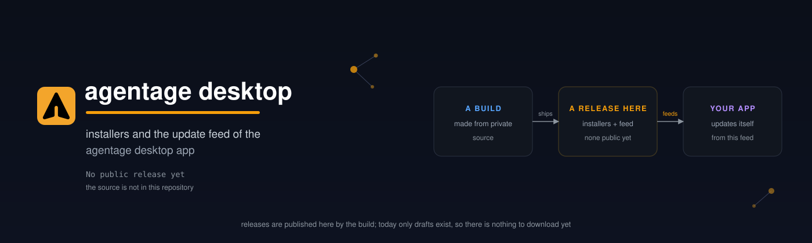

# agentage desktop

The agentage desktop app. This public repository holds its installers and its update feed, published as GitHub releases. It holds no source code, and the source is not public.

## Status

No public release yet. Only draft releases exist today, and a draft is not visible or downloadable.

## Get the app

When a release is published, open the [Releases page](https://github.com/agentage/desktop/releases), pick the newest release and download the installer for your system. The installed app then checks this feed and updates itself. Until then there is nothing to download.

## Report a problem

Open an [issue in this repository](https://github.com/agentage/desktop/issues). Say which system and which app version you use.

## For agents

- This repository holds releases only. Never push source code, build output or secrets here.
- Releases are published here by the build of the private source repository. Do not create or publish a release by hand.
- Facts for an agent: [AGENTS.md](AGENTS.md).

## Related

- [agentage/cli](https://github.com/agentage/cli): the `agentage` command line.
- [agentage/kit](https://github.com/agentage/kit): the kit for extensions.
